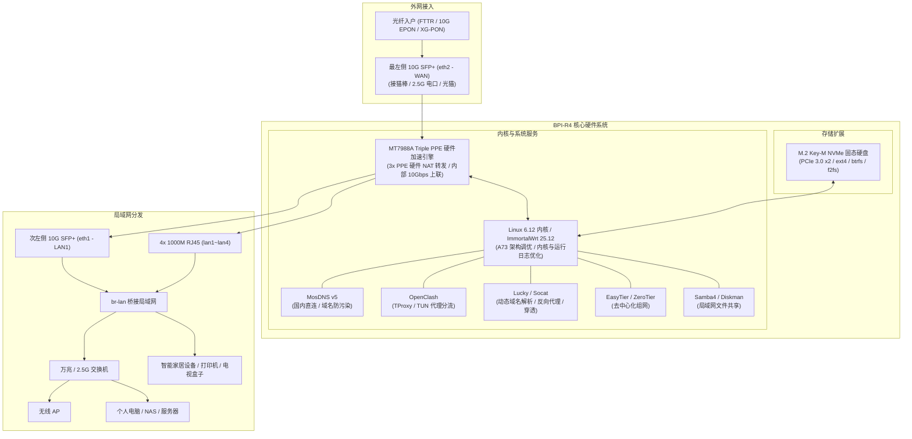

<div align="center">

# 🚀 Banana Pi BPI-R4 ImmortalWrt 纯有线固件构建

[](https://github.com/Apocalypse-Long/bpi-r4-builder/actions/workflows/build-firmware.yml)
[](https://github.com/Apocalypse-Long/bpi-r4-builder/releases)
[-blue.svg?logo=openwrt)](https://github.com/0x5826/immortalwrt-mtk)
[](LICENSE)

**为香蕉派 Banana Pi BPI-R4 (MediaTek MT7988A Filogic 880) 定制的纯有线固件**  
*双万兆 SFP+ | 硬件包转发优化 | 开箱即用 M.2 NVMe SSD 支持 | 现代 shadcn/ui 侧边栏主题*

[项目背景](#-项目背景与设计说明) • [硬件规格](#-硬件规格全景-bpi-r4) • [网络拓扑](#-推荐网络拓扑与架构) • [典型场景](#-典型适用场景) • [特性说明](#-核心特性与优化说明) • [预置套件](#-预置功能与套件清单) • [刷机指引](#-固件产物与刷机指引) • [编译说明](#-手动编译与自定义配置) • [鸣谢](#-鸣谢与开源项目)

</div>

---

## 📌 项目背景与设计说明

香蕉派 **Banana Pi BPI-R4** 搭载联发科 **MT7988A (Filogic 880)** 芯片，具备四核 ARM Cortex-A73 @ 1.8GHz 处理器、双 10G SFP+ 高速接口，以及三硬件包处理引擎（Triple PPE / 3x PPE），支持硬件包转发加速。

在家庭或小型办公网络中，常见采用 **“主路由置于机柜/弱电箱 + 交换机 + 独立无线 AP”** 的组网方式。针对此类纯有线主路由场景，本项目对固件进行了适配与精简：
1. **精简无线组件**：移除默认的无线驱动（如 mt76/mt7996/hostapd 等），减少不必要的常驻后台与内存开销；
2. **硬件转发配置优化**：适配 MT7988 硬件包处理引擎，开启硬件流表卸载以降低高负载下的 CPU 占用；
3. **补全存储驱动**：内置 M.2 NVMe 驱动与常用文件系统工具，支持直接挂载固态硬盘；
4. **管理界面升级**：默认预置基于 shadcn/ui 风格的侧边栏主题，改善管理面板的日常操作体验。

---

## 📊 硬件规格全景 (BPI-R4)

| 核心组件 | 规格与特性 | 固件适配说明 |
| :--- | :--- | :--- |
| **中央处理器 (SoC)** | 联发科 MT7988A (Filogic 880) **四核 ARM Cortex-A73 @ 1.8GHz** | 针对 Cortex-A73 架构调优编译，包含底层驱动优化 |
| **硬件转发引擎 (PPE)** | **三硬件包处理引擎（Triple PPE / 3x PPE）**，分别对应内置交换机与两个 10G SFP+ 通道 | **开启硬件流量卸载**，降低高并发 NAT 转发时的 CPU 占用 |
| **系统内存 (RAM)** | **4GB / 8GB DDR4 内存** | 移除不必要的后台清理脚本，产物提供 4GB/8GB 对应引导文件 |
| **板载闪存 (Storage)** | 8GB eMMC 5.1 / MicroSD 卡槽 / SPI NAND / SPI NOR | 设定 2048MB SquashFS 分区结构，预留充裕空间 |
| **万兆以太网口** | **2x 10G SFP+ 光口** (位于面板最左侧：最左为 WAN `eth2`，次左为 LAN `eth1`，支持 10G/2.5G/1G 自适应光电模块) | 预置 `luci-app-sfp-info` 实时查看光模块状态与 DDM 信息 |
| **千兆以太网口** | **4x 1000M RJ45** (位于 SFP+ 与 DC 电源口之间，SoC 内置 MT7988 千兆交换机 + PHY，内部 10Gbps 上联) | 默认与次左侧 SFP+ (`eth1`) 桥接为局域网 (`br-lan`) |
| **存储扩展 (M.2 Key-M)** | **1x M.2 2280 Key-M 插槽 (PCIe 3.0 x2 NVMe，双通道理论速率 16Gbps）** | **原生集成 `kmod-nvme` 及 ext4/btrfs/f2fs 常用工具** |
| **外设扩展接口** | **1x USB 3.2 Gen1 Type-A / 1x M.2 Key-B (5G) / 2x Mini-PCIe (PCIe 3.0 x2)** | 预置 USB 存储驱动；未启用内置无线驱动，底部 Mini-PCIe 槽可按需扩展其他设备 |

---

## 🌐 推荐网络拓扑与架构



---

## 🎯 典型适用场景

1. **🏠 万兆有线主路由**：
   - 适用于千兆及以上宽带或 FTTR 光纤入户场景；WAN 口使用**最左侧 10G SFP+ (eth2)** 连接光猫或猫棒，相邻的**次左侧 10G SFP+ (eth1)** 及千兆电口连接交换机与内网设备。
2. **📁 轻量级网络存储 (NAS)**：
   - 利用板载 M.2 Key-M (PCIe 3.0 x2) 插槽接入 NVMe 固态硬盘，配合 Samba4 与 Diskman 插件实现局域网文件共享，满足数百 MB/s 至万兆级别的高速读写需求。
3. **🛡️ DNS 防污染与网络分流**：
   - 配合 MosDNS v5 与 OpenClash，实现国内常用域名直连防污染与海外流量规则分流。
4. **🏢 异地组网与远程访问**：
   - 借助预置的 Lucky（DDNS/反代）与 EasyTier / ZeroTier 虚拟局域网工具，在无公网 IPv4 的网络环境下也能远程访问路由器后台与内网服务。

---

## 🌟 核心特性与优化说明

本项目基于 **[0x5826/immortalwrt-mtk](https://github.com/0x5826/immortalwrt-mtk)**（开发分支 `openwrt-25.12`，Linux 内核 6.12）构建，针对 BPI-R4 的硬件架构与主路由使用场景进行了适配与调优：

### 1. ⚡ 硬件包转发优化
- **流表与硬件卸载**：适配 MT7988 三硬件包处理引擎（Triple PPE），开启硬件流表卸载功能。在大连接数并发或跨网段 NAT 转发时，有效降低 CPU 占用，提升整体吞吐表现。

### 2. 🔇 内核与运行日志优化
- **精简日志**：对底层驱动及运行日志进行针对性过滤，去除无用的调试冗余信息，保持系统日志清晰整洁。

### 3. 🎨 现代界面主题：[luci-theme-shadcn](https://github.com/eamonxg/luci-theme-shadcn)
- **界面体验**：默认预置基于 **shadcn/ui** 风格的侧边栏主题；
- **自适应布局**：支持可折叠的多级导航菜单、暗黑模式切换，排版更紧凑；
- **备用主题**：同时保留 `luci-theme-argon` 与 `bootstrap` 供选择。

### 4. 💾 M.2 NVMe 固态硬盘与存储支持
- **NVMe 支持**：原生编译启用 `kmod-nvme`，支持板载 M.2 2280 Key-M (PCIe 3.0 x2) NVMe 固态硬盘；
- **常用文件系统**：集成 `ext4`、`btrfs`、`f2fs`、`exFAT`、`FAT32` 等文件系统驱动及常用磁盘工具（`btrfs-progs`, `smartmontools`, `fdisk`, `parted`）；
- **文件共享**：预置 **Samba4** 与 **Diskman** 磁盘管理插件，便于挂载与局域网文件共享。

### 5. 🌐 纯有线场景精简
- **精简无线驱动**：移除 `mt76`、`mt7915`、`mt7996`、`hostapd`、`wpad` 等无线驱动与固件，减少系统常驻内存与多余后台进程；
- **移除冗余脚本**：移除了不必要的定时释放内存与自动重启插件，依靠内核原生的内存管理机制，保障系统长期稳定运行。

### 6. 🚀 构建与发布流程
- **编译缓存加速**：引入 **Ccache** 与 **dl 源码包持久化缓存**，缩短后续重复编译耗时；
- **自动归档发布**：工作流构建完成后自动生成带有 SHA256 校验码的 GitHub Releases。

---

## 📦 预置功能与套件清单

| 类别 | 预置插件 / 工具 | 说明与典型用途 |
| :--- | :--- | :--- |
| **网络分流** | `luci-app-mosdns` (v5) | DNS 分流与防污染工具，带中文图形化界面 |
| **透明代理** | `luci-app-openclash` | 代理客户端，支持 TProxy 与 TUN 模式 |
| **内网穿透** | `luci-app-lucky` | 支持 DDNS 动态解析、反向代理、端口转发与 WebDAV |
| **异地组网** | `luci-app-easytier` | 去中心化 Mesh 组网工具，支持点对点内网互通 |
| **虚拟局域网** | `luci-app-zerotier` | P2P 虚拟局域网互通与内网穿透 |
| **文件共享** | `luci-app-samba4` | 局域网文件共享服务，支持 Windows / macOS 挂载 |
| **磁盘管理** | `luci-app-diskman` | 磁盘分区、格式化、挂载管理及 S.M.A.R.T. 健康检查 |
| **吞吐测速** | `luci-app-netspeedtest` | 网页端测速与 iPerf3 服务端 |
| **链路监控** | `luci-app-sfp-info` | 实时查看双 10G SFP+ 光电模块温度、电压、接收光功率 |
| **指标采集** | `prometheus-node-exporter-lua` | 系统性能与网络流量指标暴露，配合 Home Assistant / Grafana 监控 |
| **系统运维** | `luci-app-ttyd` | 网页端终端工具 (Web Shell) |
| **内核日志** | `luci-app-log` | 系统日志与内核 dmesg 查看器 |
| **端口映射** | `luci-app-upnp` / `luci-app-socat` | UPnP 端口映射与端口转发工具 |
| **现代界面** | `luci-theme-shadcn` | 默认主题：基于 shadcn/ui 风格的侧边栏主题 |

---

## 📁 固件产物与刷机指引

### 1. 常见文件辨析

每次 GitHub Actions 编译成功后，将在 [Releases 页面](https://github.com/Apocalypse-Long/bpi-r4-builder/releases) 输出以下制品：

| 文件名称匹配 | 适用场景与刷机方法 |
| :--- | :--- |
| `*sdcard.img.gz` | **MicroSD 卡镜像**：初次测试或使用 TF 卡启动时使用。<br>解压后使用 **Rufus** 或 **Etcher** 写入 MicroSD 卡。 |
| `*sysupgrade.itb` | **在线升级固件**：系统日常升级固件。<br>在 Web 后台 `系统 -> 备份/升级 -> 刷写新的固件` 处直接上传即可。 |
| `*emmc-preloader.bin`<br>`*emmc-bl31-uboot.fip` | **eMMC 引导文件**：写入 BPI-R4 板载 8GB eMMC 的引导程序（亦包含 8G 内存版对应 preloader）。 |
| `SHA256SUMS` | **校验和文件**：刷机前核对文件的 SHA256，确保固件文件完整。 |

### 2. BPI-R4 硬件启动拨码开关说明 (Boot Select)

BPI-R4 主板上带有 **2-Pin 硬件启动拨码开关**（标有 `B0`、`B1` 或 `1`、`2`，拨至 ON 侧为 `1`，OFF 侧为 `0`），用于精确选择启动介质：

| 引导介质模式 | 拨码 B0 (1) | 拨码 B1 (2) | 对应启动设备与说明 |
| :---: | :---: | :---: | :--- |
| **TF卡 (MicroSD) 启动** | **1** | **1** | 烧录 `sdcard.img.gz` 后插入卡槽测试与引导（初次推荐） |
| **eMMC 板载闪存启动** | **1** | **0** | 固件写入 eMMC 后的日常稳定启动模式 |
| **SPI-NAND 启动** | **0** | **1** | 板载 SPI NAND 存储介质启动 |
| **SPI-NOR 启动** | **0** | **0** | 板载 SPI NOR Flash 恢复介质启动 |

> [!IMPORTANT]
> **eMMC 引导激活关键步骤（必读）**：  
> 若你在系统或 Linux 环境下使用 `dd` 将 preloader 写入 eMMC 的 boot0 分区（如 `/dev/mmcblk0boot0`），**必须显式激活 Boot 分区使能**，否则将拨码切换至 eMMC 模式（`1 0`）后 SoC 无法定位引导扇区而无法开机：
> - **在 Linux 系统终端中执行**：
>   ```bash
>   mmc bootpart enable 1 1 /dev/mmcblk0
>   ```
> - **或在 U-Boot 控制台终端中执行**：
>   ```bash
>   mmc partconf 0 1 1 1
>   ```
> 激活完成后再切回拨码 `1 0`，方可正常从 eMMC 稳定引导。

> [!TIP]
> **新手推荐刷机路径**：  
> 先将拨码设为 `1 1`，用 TF 卡刷入 `sdcard.img.gz` 启动测试。验证网络、NVMe 识别及各项服务均正常后，再通过命令行或引导脚本将系统安装到板载 eMMC 并按上述步骤激活 Boot 分区。

### 3. 默认网络与后台参数（面板物理布局与网口定义）

- **默认后台地址**：`192.168.1.1`
- **默认用户**：`root`
- **默认密码**：无密码（初次登录直接回车，建议登录后立即修改）

#### 🔌 机器面板物理接口排布（面对面板接口，从左到右）：

```text
┌────────────────────────────────────────────────────────────────────────────────────────┐
│                              Banana Pi BPI-R4 前面板接口布局                           │
├────────────────────┬────────────────────┬─────────────────────────┬────────────────────┤
│     最左侧接口     │     次左侧接口     │      中间 4 个电口      │     最右侧接口     │
├────────────────────┼────────────────────┼─────────────────────────┼────────────────────┤
│    10G SFP+ 光口   │    10G SFP+ 光口   │   4x 1000M RJ45 网口    │    12V DC 电源口   │
│       (eth2)       │       (eth1)       │      (lan1 ~ lan4)      │     (圆头插孔)     │
├────────────────────┼────────────────────┼─────────────────────────┼────────────────────┤
│    默认 WAN 口     │    默认 LAN1 口    │     默认 LAN2~5 口      │      直流供电      │
│  (接光猫 / 2.5G猫棒)│   (直连交换机/PC)  │    (桥接并入 br-lan)    │   (推荐 12V / ≥4A) │
└────────────────────┴────────────────────┴─────────────────────────┴────────────────────┘
```

- **网口功能与链路分配**：
  - **WAN 口**：**最左侧 10G SFP+ 光口 (`eth2`)** 默认为外网接入 WAN 口；
  - **LAN 口**：**次左侧 10G SFP+ 光口 (`eth1`)** 与紧邻的 **4 个千兆 RJ45 网口 (`lan1` ~ `lan4`)** 默认自动桥接为局域网口 (`br-lan`)；
  - **电源接口**：**最右侧为 12V 直流 DC 电源圆孔**。

---

## 🛠️ 手动编译与自定义配置

### 1. 触发云端自动构建
1. Fork 本项目到你自己的 GitHub 账号；
2. 进入你 Fork 的仓库，点击 **Actions**；
3. 在左侧选中 **Build Banana Pi BPI-R4 Firmware**；
4. 点击右侧 **Run workflow**：
   - **选择 0x5826 源码分支**：默认推荐 `openwrt-25.12`（基于 Linux 6.12，包含最新 Filogic 补丁）；
   - **是否发布到 GitHub Releases**：勾选后会自动创建 Release 并归档固件。

### 2. 自定义配置指南
* **增删预置软件包**：修改根目录下的 `bpir4.config` 文件；
* **注入额外内核/系统补丁**：将 `.patch` 文件放入 `patches/` 目录中。
  > 工作流会自动判断：若为驱动底层补丁（`drivers/` 等）会自动派发到 `target/linux/mediatek/patches-*`；若为基础补丁会自动在源码根目录打入。
* **自定义预置配置文件**：如需开箱自带网络规则或网络配置，可在根目录下创建 `files/` 文件夹（例如 `files/etc/config/network`），编译时将自动合并进系统固件。

---

## 📜 鸣谢与开源项目

- [0x5826/immortalwrt-mtk](https://github.com/0x5826/immortalwrt-mtk) - MTK Filogic 平台固件分支
- [ImmortalWrt 官方社区](https://github.com/immortalwrt/immortalwrt) & [OpenWrt 官方项目](https://github.com/openwrt/openwrt)
- [eamonxg/luci-theme-shadcn](https://github.com/eamonxg/luci-theme-shadcn) - 现代化 shadcn/ui 侧边栏主题
- [sbwml/luci-app-mosdns](https://github.com/sbwml/luci-app-mosdns) - MosDNS v5 中文管理套件
- [gdy666/luci-app-lucky](https://github.com/gdy666/luci-app-lucky) - Lucky 端口转发与反代工具
- [EasyTier](https://github.com/EasyTier/luci-app-easytier) - 去中心化 Mesh 组网工具
