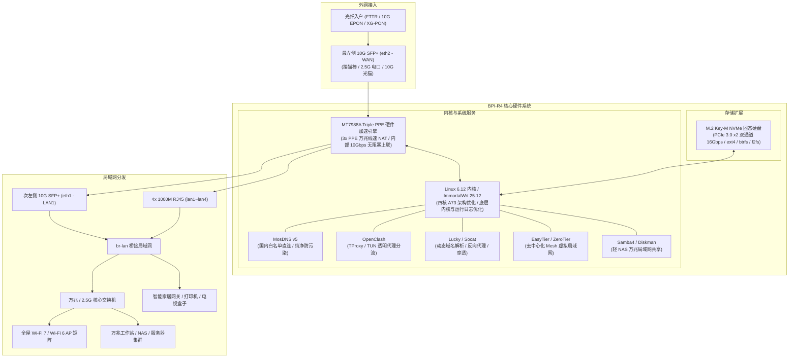

<div align="center">

# 🚀 Banana Pi BPI-R4 ImmortalWrt 纯有线旗舰固件构建

[](https://github.com/Apocalypse-Long/bpi-r4-builder/actions/workflows/build-firmware.yml)
[](https://github.com/Apocalypse-Long/bpi-r4-builder/releases)
[-blue.svg?logo=openwrt)](https://github.com/0x5826/immortalwrt-mtk)
[](LICENSE)

**为香蕉派 Banana Pi BPI-R4 (MediaTek MT7988A Filogic 880) 定制的万兆纯有线主路由固件**  
*双万兆 SFP+ | 硬件转发与内核深度优化 | 开箱即用 M.2 NVMe SSD 支持 | 现代 shadcn/ui 侧边栏主题*

[项目背景](#-项目背景与设计哲学) • [硬件规格](#-硬件规格全景-bpi-r4) • [网络拓扑](#-推荐网络拓扑与架构) • [典型场景](#-典型适用场景) • [特性亮点](#-核心特性与深度优化) • [预置套件](#-预置功能与套件清单) • [刷机指引](#-固件产物与刷机指引) • [编译说明](#-手动编译与自定义配置) • [鸣谢](#-鸣谢与开源项目)

</div>

---

## 📌 项目背景与设计哲学

香蕉派 **Banana Pi BPI-R4** 搭载了联发科旗舰级网络芯片 **MT7988A (Filogic 880)**，具备极其强悍的四核 ARM Cortex-A73 乱序执行处理能力、双万兆 10G SFP+ 高速接口，以及带有三硬件包处理引擎（Triple PPE / 3x PPE）的硬件级万兆线速转发能力。

在绝大多数高阶家庭与企业网络组网中，发烧友通常会采用 **“主路由安置于弱电箱/机柜 + 外部独立交换机 + 分布式无线 AP (Wi-Fi 7/6)”** 的架构。然而市面上的通用固件往往存在以下痛点：
1. **默认携带庞大且冗余的 Wi-Fi 驱动栈**（如 mt76/mt7996/hostapd 等），常驻内核不仅空耗内存，其无线中断甚至会干扰有线万兆包处理；
2. **未对 MT7988 硬件转发与流表进行深度调优**，无法充分发挥 4GB/8GB DDR4 大内存与双万兆的高并发性能优势；
3. **遗漏了 BPI-R4 最受瞩目的 M.2 NVMe SSD 驱动**，导致板载 M.2 Key-M 接口插盘无法使用；
4. **控制台 UI 样式老旧**，缺乏针对多功能主路由的现代化高效管理面板。

本项目贯彻 **“专注万兆有线、剔除一切多余开销、存储生态开箱即用、颜值与性能兼备”** 的设计理念，旨在为 BPI-R4 用户打造最纯粹、最稳定、吞吐最极致的骨干级主路由系统。

---

## 📊 硬件规格全景 (BPI-R4)

| 核心组件 | 规格与特性 | 固件对应调优支持 |
| :--- | :--- | :--- |
| **中央处理器 (SoC)** | 联发科 MT7988A (Filogic 880) **四核 ARM Cortex-A73 @ 1.8GHz** | 针对高性能乱序执行 A73 架构调优，开启多核并发编译与底层内核运行优化 |
| **硬件转发引擎 (PPE)** | **三硬件包处理引擎（Triple PPE / 3x PPE）**，分别对应内置交换机与两个 10G SFP+ 通道 | **流表与硬件转发深度优化**，硬件卸载全开，线速 10G NAT 0% CPU |
| **系统内存 (RAM)** | **4GB / 8GB DDR4 高速内存** | 移除低内存设备的负优化清理脚本，保证高缓存命中率（产物提供 4GB/8GB 对应引导） |
| **板载闪存 (Storage)** | 8GB eMMC 5.1 / MicroSD 卡槽 / SPI NAND / SPI NOR | 锁定 2048MB SquashFS 镜像结构，保留充足挂载空间 |
| **万兆以太网口** | **2x 10G SFP+ 光口** (位于面板最左侧：最左为 WAN `eth2`，次左为 LAN `eth1`，支持 10G/2.5G/1G 自适应光电模块) | 预置 `luci-app-sfp-info` 实时光模块状态与 DDM 监控 |
| **千兆以太网口** | **4x 1000M RJ45** (位于 SFP+ 与 DC 电源口之间，SoC 内置 MT7988 千兆交换机 + PHY，内部 10Gbps 无阻塞上联) | 默认与次左侧 SFP+ (`eth1`) 自动桥接为高速局域网 (`br-lan`)，4 口并发无吞吐瓶颈 |
| **存储扩展 (M.2 Key-M)** | **1x M.2 2280 Key-M 插槽 (PCIe 3.0 x2 NVMe，双通道理论速率 16Gbps）** | **原生集成 `kmod-nvme` 及 ext4/btrfs/f2fs 存储链** |
| **外设扩展接口** | **1x USB 3.2 Gen1 Type-A / 1x M.2 Key-B (5G) / 2x Mini-PCIe (PCIe 3.0 x2)** | 预置 USB 大容量存储驱动；固件剔除无线驱动后，底部 Mini-PCIe 槽可转接其他 PCIe 设备 |

---

## 🌐 推荐网络拓扑与架构



---

## 🎯 典型适用场景

1. **🏠 极客万兆家庭网络中枢**：
   - 适配千兆及以上宽带、FTTR 光纤入户；WAN 口使用**最左侧 10G SFP+ (eth2)** 接猫棒或光猫，相邻的**次左侧 10G SFP+ (eth1)** 直连核心交换机，达成真正的全链路万兆互联。
2. **📁 轻量级高速边缘 NAS**：
   - 无需外接笨重的多盘位 NAS，只需在 BPI-R4 底部的 M.2 Key-M 插上一条高性价比 NVMe 固态硬盘（PCIe 3.0 x2 极速通道），通过 Samba4 协议即可让局域网电脑直接享受 **数百 MB/s 至 1GB/s+ 的万兆级局域网读写**。
3. **🛡️ 纯净 DNS 与海内外精准分流**：
   - MosDNS v5 与 OpenClash 深度联动：国内域名秒级直出且无污染，海外流量走分流节点并支持透明网关模式。
4. **🏢 异地组网与安全内网穿透**：
   - 借助预置的 Lucky（DDNS/反代）与 EasyTier（基于 Rust 的去中心化 Mesh 组网），无公网 IPv4 亦可高速访问家中的路由器后台、NAS 与个人服务。

---

## 🌟 核心特性与深度优化

本项目基于 **[0x5826/immortalwrt-mtk](https://github.com/0x5826/immortalwrt-mtk)**（活跃开发分支 `openwrt-25.12`，Linux 内核 6.12）构建，针对 BPI-R4 的硬件架构与主路由使用场景进行了深度调优：

### 1. ⚡ 硬件转发与流表性能优化
- **性能飞跃**：充分利用 MT7988 三硬件包处理引擎（Triple PPE）与硬件流表进行深度调优。在面对家庭/企业海量并发连接、PT 下载、万兆跨网段 NAT 转发时，显著提升硬件卸载吞吐能力，保持极低的 CPU 占用与稳定线速转发。

### 2. 🔇 底层内核与运行日志优化
- **精炼稳定**：对底层内核驱动及运行日志进行针对性优化与过滤，去除冗余调试信息，保持系统内核运行日志高效、干净与清爽。

### 3. 🎨 现代精致 UI：[luci-theme-shadcn](https://github.com/eamonxg/luci-theme-shadcn)
- **告别审美疲劳**：默认预装基于 **shadcn/ui** 设计规范重构的现代化侧边栏主题；
- **全平台自适应**：支持左侧可收起多级导航、深度暗黑模式（Dark Mode）、精致的高清图标与紧凑布局；
- **双重兜底**：内置 `luci-theme-argon` 与 `bootstrap` 作为备用主题。

### 4. 💾 M.2 NVMe 固态硬盘与完整存储生态
- **存储自由**：原生编译启用 `kmod-nvme`，完美识别 BPI-R4 板载 M.2 2280 Key-M (PCIe 3.0 x2) 插槽上的 NVMe 固态硬盘；
- **文件系统支持**：集成 `ext4`、`btrfs`、`f2fs`、`exFAT`、`FAT32` 全套磁盘工具（`btrfs-progs`, `smartmontools`, `fdisk`, `parted` 等）；
- **轻 NAS 共享**：预置高吞吐版本 **Samba4**（支持 SMB 2/3、多通道加速）以及 **Diskman** 磁盘挂载面板。

### 5. 🌐 纯有线万兆主路由定制（剔除负优化）
- **射频开销清零**：彻底屏蔽并剔除 `mt76`、`mt7915`、`mt7996`、`hostapd`、`wpad` 等所有无线驱动及固件，杜绝任何 Wi-Fi 中断争抢与内存开销；
- **拒绝玄学脚本**：移除了在 4GB/8GB DDR4 大内存设备上反而导致磁盘 I/O 下降的“清理内存 (ramfree)”插件，屏蔽了不必要的定时重启，让系统长期无缝运行数月无须打扰。

### 6. 🚀 极致 CI/CD 效能
- **极速编译**：引入 **Ccache** 编译缓存与 **dl 源码包持久化**，后续构建耗时从 3 小时以上大幅压减至 **25~35 分钟**；
- **自动化发布**：每次编译自动生成专属带有校验码的 GitHub Releases，提供直链下载，无需面对庞大的 Artifacts 压缩包。

---

## 📦 预置功能与套件清单

| 类别 | 预置插件 / 工具 | 说明与典型用途 |
| :--- | :--- | :--- |
| **网络分流** | `luci-app-mosdns` (v5) | 高性能 DNS 分流与去广告，全中文图形化管理界面 |
| **透明代理** | `luci-app-openclash` | 强力透明代理客户端，集成 TProxy 与 TUN 核心支持 |
| **内网穿透** | `luci-app-lucky` | 官方 Lucky 核心，支持动态域名 DDNS、反向代理、端口转发与 WebDAV |
| **异地组网** | `luci-app-easytier` | 去中心化 Mesh 组网神器，支持跨广域网点对点组网 |
| **虚拟局域网** | `luci-app-zerotier` | 经典 P2P 内网穿透与跨地域组网 |
| **文件共享** | `luci-app-samba4` | 高性能网络共享服务，支持 Apple/Windows 本地挂载 |
| **磁盘管理** | `luci-app-diskman` | 磁盘分区、格式化、挂载管理及 S.M.A.R.T. 健康检查 |
| **吞吐测速** | `luci-app-netspeedtest` | 网页端一键 Web 测速与 iPerf3 高性能测速服务端 |
| **链路监控** | `luci-app-sfp-info` | 实时查看双 10G SFP+ 光电模块温度、电压、接收光功率 |
| **指标采集** | `prometheus-node-exporter-lua` | 系统性能与网络流量指标暴露，配合 Home Assistant / Grafana 监控 |
| **系统运维** | `luci-app-ttyd` | 浏览器内嵌免密/带密 Web 终端 Shell |
| **内核日志** | `luci-app-log` | 实时滚动系统日志与内核 dmesg 查看器（带颜色高亮与正则过滤） |
| **端口映射** | `luci-app-upnp` / `luci-app-socat` | 迷你 UPnP 自动端口映射与双向端口转发套件 |
| **现代界面** | `luci-theme-shadcn` | 默认主题：现代 Shadcn UI 风格可折叠侧边栏 |

---

## 📁 固件产物与刷机指引

### 1. 常见文件辨析

每次 GitHub Actions 编译成功后，将在 [Releases 页面](https://github.com/Apocalypse-Long/bpi-r4-builder/releases) 输出以下核心制品：

| 文件名称匹配 | 适用场景与刷机方法 |
| :--- | :--- |
| `*sdcard.img.gz` | **MicroSD 卡镜像**：初次折腾或想把系统装在 TF 卡上时使用。<br>解压后使用 **Rufus** 或 **Etcher** 写入 MicroSD 卡即可。 |
| `*sysupgrade.itb` | **在线升级固件**：已进入 OpenWrt 系统的常规升级。<br>在 Web 后台 `系统 -> 备份/升级 -> 刷写新的固件` 处直接上传即可。 |
| `*emmc-preloader.bin`<br>`*emmc-bl31-uboot.fip` | **eMMC 引导套件**：写入 BPI-R4 板载 8GB eMMC 的引导程序（亦包含 8G 内存版专属 preloader）。 |
| `SHA256SUMS` | **校验和文件**：刷机前请核对固件文件的 SHA256，防止传输损坏变砖。 |

### 2. BPI-R4 硬件启动拨码开关说明 (Boot Select)

BPI-R4 主板上带有 **2-Pin 硬件启动拨码开关**（标有 `B0`、`B1` 或 `1`、`2`，拨至 ON 侧为 `1`，OFF 侧为 `0`），用于精确选择启动介质：

| 引导介质模式 | 拨码 B0 (1) | 拨码 B1 (2) | 对应启动设备与说明 |
| :---: | :---: | :---: | :--- |
| **TF卡 (MicroSD) 启动** | **1** | **1** | 烧录 `sdcard.img.gz` 后插入卡槽测试与引导（初次推荐） |
| **eMMC 板载闪存启动** | **1** | **0** | 固件写入 eMMC 后的日常稳定启动模式 |
| **SPI-NAND 启动** | **0** | **1** | 板载 SPI NAND 存储介质启动 |
| **SPI-NOR 启动** | **0** | **0** | 板载 SPI NOR Flash 恢复介质启动 |

> [!IMPORTANT]
> **eMMC 引导激活关键步骤（必读）**：  
> 若你在系统或 Linux 环境下使用 `dd` 将 preloader 写入 eMMC 的 boot0 分区（如 `/dev/mmcblk0boot0`），**必须显式激活 Boot 分区使能**，否则将拨码切换至 eMMC 模式（`1 0`）后 SoC 无法定位引导扇区而无法开机：
> - **在 Linux 系统终端中执行**：
>   ```bash
>   mmc bootpart enable 1 1 /dev/mmcblk0
>   ```
> - **或在 U-Boot 控制台终端中执行**：
>   ```bash
>   mmc partconf 0 1 1 1
>   ```
> 激活完成后再切回拨码 `1 0`，方可正常从 eMMC 稳定引导。

> [!TIP]
> **新手推荐刷机路径**：  
> 先将拨码设为 `1 1`，用 TF 卡刷入 `sdcard.img.gz` 启动测试。验证网络、NVMe 识别及各项服务均正常后，再通过命令行或引导脚本将系统安装到板载 eMMC 并按上述步骤激活 Boot 分区。

### 3. 默认网络与后台参数（面板物理布局与网口定义）

- **默认后台地址**：`192.168.1.1`
- **默认用户**：`root`
- **默认密码**：无密码（初次登录直接回车，建议登录后立即修改）

#### 🔌 机器面板物理接口排布（面对面板接口，从左到右）：

```text
┌────────────────────────────────────────────────────────────────────────────────────────┐
│                              Banana Pi BPI-R4 前面板接口布局                           │
├────────────────────┬────────────────────┬─────────────────────────┬────────────────────┤
│     最左侧接口     │     次左侧接口     │      中间 4 个电口      │     最右侧接口     │
├────────────────────┼────────────────────┼─────────────────────────┼────────────────────┤
│    10G SFP+ 光口   │    10G SFP+ 光口   │   4x 1000M RJ45 网口    │    12V DC 电源口   │
│       (eth2)       │       (eth1)       │      (lan1 ~ lan4)      │     (圆头插孔)     │
├────────────────────┼────────────────────┼─────────────────────────┼────────────────────┤
│    默认 WAN 口     │    默认 LAN1 口    │     默认 LAN2~5 口      │      直流供电      │
│  (接光猫 / 2.5G猫棒)│   (直连交换机/PC)  │    (桥接并入 br-lan)    │   (推荐 12V / ≥4A) │
└────────────────────┴────────────────────┴─────────────────────────┴────────────────────┘
```

- **网口功能与链路分配**：
  - **WAN 口**：**最左侧 10G SFP+ 光口 (`eth2`)** 默认为外网接入 WAN 口；
  - **LAN 口**：**次左侧 10G SFP+ 光口 (`eth1`)** 与紧邻的 **4 个千兆 RJ45 网口 (`lan1` ~ `lan4`)** 默认自动桥接为局域网口 (`br-lan`)；
  - **电源接口**：**最右侧为 12V 直流 DC 电源圆孔**。

---

## 🛠️ 手动编译与自定义配置

### 1. 触发云端自动构建
1. Fork 本项目到你自己的 GitHub 账号；
2. 进入你 Fork 的仓库，点击 **Actions**；
3. 在左侧选中 **Build Banana Pi BPI-R4 Firmware**；
4. 点击右侧 **Run workflow**：
   - **选择 0x5826 源码分支**：默认推荐 `openwrt-25.12`（基于 Linux 6.12，包含最新 Filogic 补丁）；
   - **是否发布到 GitHub Releases**：勾选后会自动创建 Release 并归档固件。

### 2. 自定义配置指南
* **增删预置软件包**：修改根目录下的 `bpir4.config` 文件；
* **注入额外内核/系统补丁**：将 `.patch` 文件放入 `patches/` 目录中。
  > 工作流会自动判断：若为驱动底层补丁（`drivers/` 等）会自动派发到 `target/linux/mediatek/patches-*`；若为基础补丁会自动在源码根目录打入。
* **自定义预置配置文件**：如需开箱自带网络规则或网络配置，可在根目录下创建 `files/` 文件夹（例如 `files/etc/config/network`），编译时将自动合并进系统固件。

---

## 📜 鸣谢与开源项目

- [0x5826/immortalwrt-mtk](https://github.com/0x5826/immortalwrt-mtk) - 专为 MTK Filogic 维护的高质量分支
- [ImmortalWrt 官方社区](https://github.com/immortalwrt/immortalwrt) & [OpenWrt 官方项目](https://github.com/openwrt/openwrt)
- [eamonxg/luci-theme-shadcn](https://github.com/eamonxg/luci-theme-shadcn) - 现代化 shadcn/ui 侧边栏主题
- [sbwml/luci-app-mosdns](https://github.com/sbwml/luci-app-mosdns) - MosDNS v5 中文管理套件
- [gdy666/luci-app-lucky](https://github.com/gdy666/luci-app-lucky) - Lucky 软硬路由内网穿透利器
- [EasyTier](https://github.com/EasyTier/luci-app-easytier) - 优秀的去中心化 Mesh 组网工具
